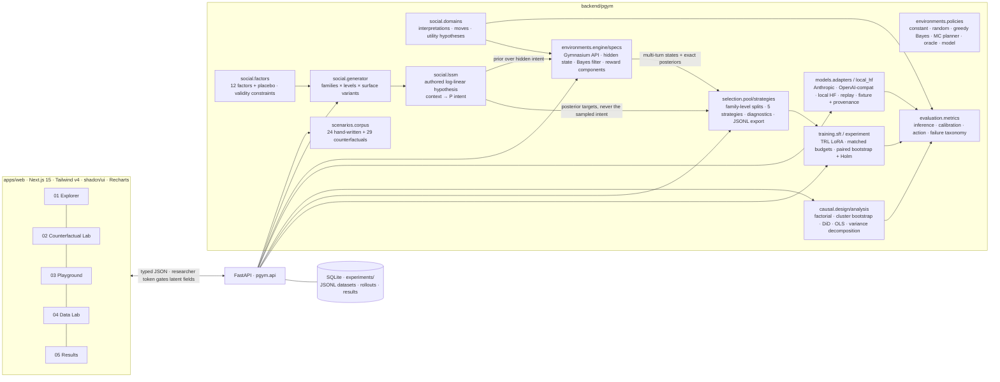

# Pragmatic Gym

**A research workbench for teaching language models social intelligence through interaction.**

> *“That sounds fun. I'll let you know!”* might be genuine enthusiasm, a polite no, a way of keeping options open, or truly undecided. People resolve this from relationship, shared history, audience and stakes. Pragmatic Gym asks three questions:
> - Can models learn to make the same inference?
> - Which training experiences teach it?
> - Does the improvement generalize?

Pragmatic Gym is one working vertical slice of a data-centric research loop:

```
Diagnose  →  Intervene  →  Generate  →  Train  →  Evaluate
(Explorer)  (Counterfactual Lab)  (Social RL)  (Data Lab → LoRA SFT)  (Results)
```

The intellectual claim is that **the structure and selection of training experiences can be studied as a mechanism for producing new model capabilities**. The app is that claim, built as software.

---

## What's in it

| View | What it does | Status |
|---|---|---|
| **01 Capability Explorer** | 24 hand-written personal-conversation scenarios plus 29 counterfactual variants across 8 pragmatic capabilities, shown as a messaging UI with a research panel:<br>• interpretation distribution vs authored reference<br>• uncertainty<br>• chosen move vs decision-theoretically best move<br>• failure taxonomy<br>• latent state, visible to researchers only<br>Also runs a corpus-wide diagnosis. | ✅ live inference |
| **02 Counterfactual Lab** | A factorial designer over 12 observable social factors plus a placebo control, with the utterance held fixed. Surface variants (names, paraphrases, sentence order, punctuation) are the clusters. Outputs:<br>• cell means vs hypothesis<br>• treatment effects (cluster bootstrap)<br>• DiD interactions<br>• OLS with cluster-robust SEs<br>• context-vs-wording variance decomposition<br>• sensitivity slope and calibration gap<br>• paired comparisons<br>• human-divergence slot | ✅ live inference |
| **03 Social RL Playground** | Five Gymnasium-style environments sharing one table-driven engine. Each has a hidden intent, a stochastic interlocutor, an exact observable Bayes filter, seven decomposed reward components and a horizon. You can play, let a model act, or run the Bayes policy. A reward audit compares constant, stylistic, random, greedy-Bayes, POMDP-planner and greedy-oracle policies. | ✅ Soft No and Same Page are flagships; all 5 run |
| **04 Data Intervention Lab** | Turns a diagnosed failure into training data. Strategies: random, diversity (k-center/TF-IDF), failure-targeted, counterfactual-contrast clusters, and an isolated-utterance ablation, all at matched token budgets. Shows per-example "why included". Diagnoses leakage, duplicates, imbalance and train/eval overlap. Exports SFT and preference JSONL. | ✅ |
| **05 Post-Training & Results** | Real LoRA SFT (TRL) of Qwen2.5-0.5B-Instruct per arm × seed, the same config for every arm. Evaluation covers held-out cells, unseen utterance families, an unseen domain and the hand-written corpus. Includes pre-registered tests (paired bootstrap, Holm), context sensitivity, calibration, action regret, deference bait, paraphrase stability and a regression tripwire. | ✅ real runs (see `experiments/results/`) |

Every model number on screen carries a **provenance badge**:

| Badge | Meaning |
|---|---|
| ● accent dot | Live inference |
| ○ ring | Replay of a recorded inference |
| ▨ hatched square, labeled **FIXTURE** | Deterministic heuristic, not a model |

Every reference distribution is labeled **synthetic / authored hypothesis**. No number is fabricated, and training results appear only once a real run has finished.

## Quick start

```bash
make install     # Python 3.11 venv via uv (+ torch/transformers/peft/trl) and npm deps
make dev         # API on :8000, web on :3000  →  http://localhost:3000
make test        # 87 tests, ~20 s, CPU only
```

**Recorded mode (default).** The app serves saved outputs of the local model from `data/recorded/local_qwen.json` and never runs a model, so it starts instantly and can't stall mid-demo. Results are labeled *Recorded local inference* with their recording date. `scripts/record_demo.py` regenerates the recordings. It covers every Explorer scenario, the corpus diagnosis, every Counterfactual Lab preset, any single variable compared on its own (up to 6 surface variants), every reward audit, and every Data Lab selection, comparison and export. Anything outside that shows a "not recorded" message.

**Live mode.** Set `PGYM_LIVE=1` to run models live. Real inference works offline with a local open-weight model. The first run downloads `Qwen/Qwen2.5-0.5B-Instruct` (≈1 GB) from Hugging Face. Other backends (selected in the header):

| Backend | Enable with | Notes |
|---|---|---|
| `local_hf` (default) | nothing | Next-token letter distribution, averaged over all cyclic option orders. Apple MPS / CUDA / CPU. |
| `anthropic` | `ANTHROPIC_API_KEY` (+ `ANTHROPIC_WORKSPACE_ID` if the key isn't scoped to a workspace) | `claude-opus-5-5` by default (`PGYM_ANTHROPIC_MODEL`, `PGYM_ANTHROPIC_EFFORT`). Structured JSON output; results are recorded for replay. |
| `openai_compat` | `PGYM_OPENAI_BASE_URL`, `PGYM_OPENAI_MODEL` | Any vLLM / llama.cpp / LM Studio server. |
| `replay` | recorded runs in `data/fixtures/recorded_inference.jsonl` | Labeled with the original model and timestamp. |
| `fixture` | always | Keyword heuristic for offline UI demos. Never presented as inference. |

On the machine used to build this, the provided `ANTHROPIC_API_KEY` returned *"This API key is not scoped to a workspace … include the anthropic-workspace-id header"*. The API shows that reason verbatim in `/api/status` and falls back to `local_hf`. Set `ANTHROPIC_WORKSPACE_ID` to enable Claude.

### Reproduce the post-training experiment

```bash
make pool          # deterministic candidate pool + eval sets (data/pools/)
make score-pool    # base-model failure scores used by failure-targeted selection (~7 min, M-series)
make experiment    # 5 arms × 3 seeds + base, ~2 h on an M-series laptop; resumable
backend/.venv/bin/python scripts/aggregate.py --exp social-sft-v1   # re-aggregate from cached predictions
```

`configs/sft_lora.yaml` holds the single matched configuration. The optional DPO extension is `python -m pgym.training.dpo`, kept separate so it doesn't confound the SFT comparison.

## Architecture



**Key invariant.** `Scenario.observable()` is the only thing a prompt builder, an agent or a training exporter can see. Hidden intents, reference labels, LSSM terms and factor IDs live elsewhere and are enforced by `tests/test_leakage.py`.

## Repository layout

```text
apps/web/                 Next.js app (design tokens in src/app/globals.css)
backend/pgym/
  social/                 domains, factors, LSSM, template generator
  scenarios/              typed schema + hand-written corpus loader
  environments/           engine, five specs, reference policies + reward audit
  models/                 inference adapters, prompts, local HF scoring
  evaluation/             item metrics, failure taxonomy, runners
  causal/                 factorial design + estimators
  selection/              candidate pool, strategies, diagnostics, export
  training/               MC format, TRL SFT/DPO, experiment runner, TRL macOS shim
  storage/                SQLite experiment index
  api/                    FastAPI app
data/scenarios/handwritten.yaml   the corpus (synthetic; authored references with rationales)
data/pools/               deterministic candidate pool + eval sets (+ base-model scores)
data/eval/                regression tripwire, human-annotation schema
configs/sft_lora.yaml     matched training configuration
experiments/              runs/, results/, counterfactual/ (persisted outputs)
scripts/                  dev, score_pool, run_experiment, aggregate, export_annotation_batch, screenshots
tests/                    environment, leakage, rewards (incl. hacking probes), evaluation, causal, API
```

## Scientific stance (short version — see [RESEARCH.md](RESEARCH.md))

- **No forced single ground truth.** Ambiguous messages carry reference distributions, and top-1 accuracy is scored only on decisive items.
- **Four capabilities scored separately:** inference, calibration, action under uncertainty, and interaction outcome.
- **References and rewards are hypotheses.** The LSSM and utility tables are authored, versioned and auditable, and are designed to be replaced by human distributions (`data/eval/human_annotations.schema.json`).
- **Prompt interventions estimate effects on model behavior,** not on human interpretation.
- **Culture is an explicitly stated norm,** never inferred from identity. Names are randomized as part of each surface variant.
- **Style can't score.** Evaluation reads next-token option probabilities, and reward never reads message text. Deference bait and paraphrase stability are measured explicitly.

## Design

- white paper, `#111` ink and a single `#FF3B00` accent;
- tight neo-grotesk type (Inter Tight);
- one heavy rule and square corners;
- dots as the data language: every probability distribution is a row of dots.

Tokens and decisions are in [DESIGN_SYSTEM.md](DESIGN_SYSTEM.md). App screenshots are in `docs/design/app/`.

## Docs

- [RESEARCH.md](RESEARCH.md): hypotheses, methodology, controls, metrics, results, limitations and the reviewer pass
- [DEMO.md](DEMO.md): 7-minute live walkthrough
- [FUTURE_RESEARCH.md](FUTURE_RESEARCH.md): how this becomes a research program
- [DESIGN_SYSTEM.md](DESIGN_SYSTEM.md)
